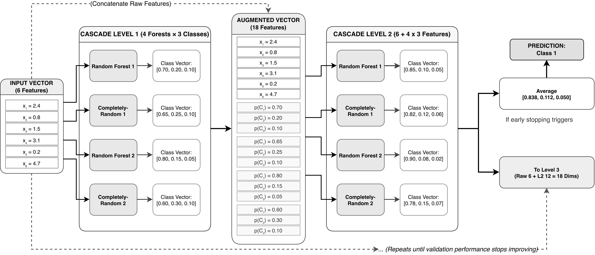
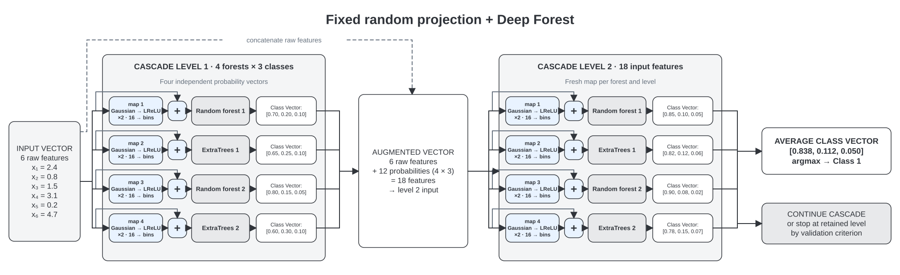
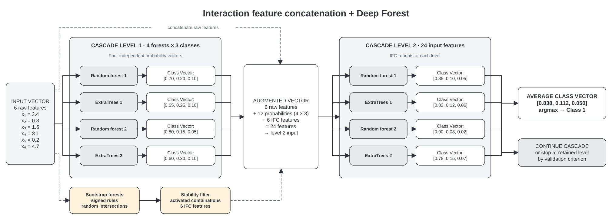
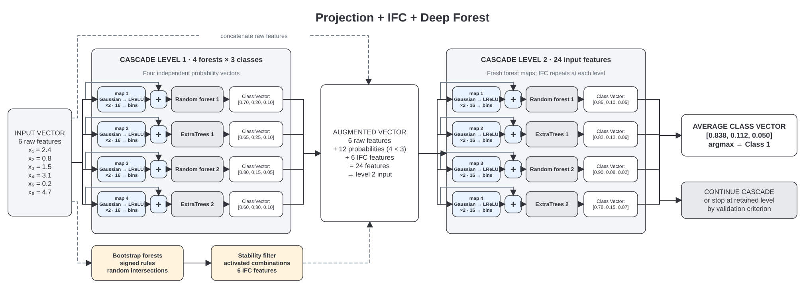

# IFC and fixed random projections in Deep Forest

This experiment compares four architectures on identical stratified folds: standard Deep Forest, fixed random nonlinear projections, an adaptation of hiDF-style interaction feature concatenation (IFC), and both changes together. 

## Architecture diagrams

These schematics use an example with six input features, four forests, and three classes. The actual feature and class counts depend on the dataset.

### Standard Deep Forest (`bare`)



### Fixed random projections (`projection`)



### Interaction feature concatenation (`ifc`)



### Projections and IFC (`combined`)



## Methods

Each projected RF or ExtraTrees estimator receives its layer input plus the output of its own seeded, untrained, two-layer Gaussian random mapping with LeakyReLU activations. The random weights stay fixed between fitting and prediction, and the package's binner maps the added features to the `uint8` format required by its custom trees. Forest training, out-of-bag probability features, cascade growth, and early stopping come from `deep-forest-py310`.

The [IFC adapter](interaction_features.py) follows the rule-interaction procedure in the authors' [hiDF source](https://github.com/lyushenhuan/chen2021improving/blob/e1d8d31a8628819d73e75741880d0850c39dfbd1/hiDF/hiDF_utils_threshold.py): bootstrap forests, signed decision rules, random intersection trees, stability filtering, and activated linear-combination features. The adapter also retains two-condition sub-rules of each intersection so repeatable low-order patterns can be matched across bootstrap forests. Selected interaction features join the probability vector passed to the next cascade layer; in the combined model, the interaction extractor can use both raw and projected features from one forest's input. The outer test fold is never passed to the interaction extractor.

This adapts hiDF's feature generation within a supervised cascade classifier. The projection component is inspired by Deep Isolation Forest.

## Setup and run

Sync the uv-managed project environment using the [repository setup instructions](../../README.md#environment).
From the repository root, run the default five-fold comparison with:

```bash
uv run -m experiments.ifc_projection.run_experiment
```


## Reusable classifier

Import [DeepForestVariantClassifier](models.py) and choose `variant="bare"`, `"projection"`, `"ifc"`, or `"combined"`.
The class supports scikit-learn's `get_params`, `set_params`, `clone`, `fit`, `predict`, `predict_proba`, and `score` interfaces.

```python
from experiments.ifc_projection import DeepForestVariantClassifier

model = DeepForestVariantClassifier(variant="combined", n_trees=50, random_state=42)
model.fit(X_train, y_train)
predictions = model.predict(X_test)
probabilities = model.predict_proba(X_test)
```
