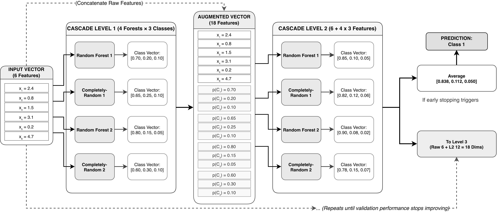
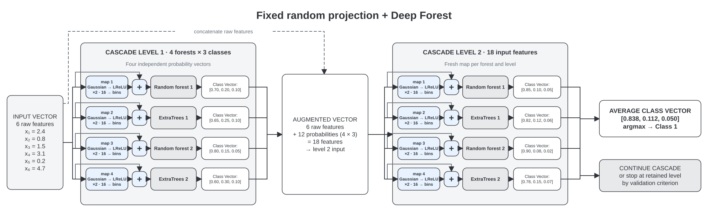
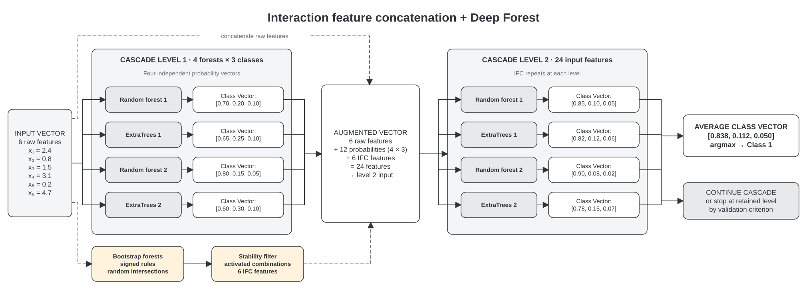
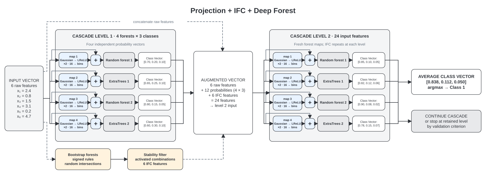

# IFC and fixed random projections in Deep Forest

This experiment compares four architectures on identical stratified folds: standard Deep Forest, fixed random nonlinear projections, an adaptation of hiDF-style interaction feature concatenation (IFC), and both changes together. 

The optional `utility_ifc` variant compares candidate forests and IFC channels with inner-fold balanced-accuracy scoring, adds only conditionally useful groups, and pads selected feedback to a fixed width for the next cascade layer. It uses greedy conditional selection: each new group must improve inner-fold score after the already-selected groups, and the score improvement must exceed a minimum utility threshold plus a feature-cost penalty.

Run the focused comparison with:

```bash
uv run -m experiments.ifc_projection.run_experiment --dataset breast_cancer --variants bare ifc utility_ifc --folds 5 --seeds 42
```

A small breast-cancer pilot and the exact selected groups are saved in [results/utility_feedback_breast_cancer_seed42.json](results/utility_feedback_breast_cancer_seed42.json). It is a two-fold implementation check, not enough evidence to claim a general improvement.

## Architecture diagrams

These schematics use an example with six input features, four forests, and three classes. The actual feature and class counts depend on the dataset.

### Standard Deep Forest (`bare`)



### Fixed random projections (`projection`)



### Interaction feature concatenation (`ifc`)



### Projections and IFC (`combined`)



## Methods

Each projected RF or ExtraTrees estimator receives its binned layer input plus the output of its own seeded, untrained, two-layer Gaussian random mapping with LeakyReLU activations. Each map uses the **unbinned raw features**, and only its output is then binned to the `uint8` format required by the custom trees. Maps remain distinct per forest and layer, with fixed weights between fitting and prediction. A projection width of zero disables the map. Forest training and out-of-bag probability features come from `deep-forest-py310`.

The [IFC adapter](interaction_features.py) follows the rule-interaction procedure in the authors' [hiDF source](https://github.com/lyushenhuan/chen2021improving/blob/e1d8d31a8628819d73e75741880d0850c39dfbd1/hiDF/hiDF_utils_threshold.py): bootstrap forests, signed decision rules, random intersection trees, stability filtering, and activated linear-combination features. The adapter also retains two-condition sub-rules of each intersection so repeatable low-order patterns can be matched across bootstrap forests. Training-row IFC values are generated out of fold: the extractor producing a row's features has not seen its label. A full-training extractor is fitted for prediction on new rows. Channels are ordered by rule rank, so fold-specific rules can differ. Selected IFC features join the probability vector passed to the next cascade layer. The outer test fold is never passed to the interaction extractor.

The public classifier chooses cascade depth using a separate stratified validation slice of its training data, then refits the chosen depth on all training rows. Setting `validation_fraction=0` restores the package's internal out-of-bag stopping behavior for controlled comparisons.

This adapts hiDF's feature generation within a supervised cascade classifier. The projection component is inspired by Deep Isolation Forest.

## Setup and run

Sync the uv-managed project environment using the [repository setup instructions](../../README.md#environment).
From the repository root, run the default five-fold comparison with:

```bash
uv run -m experiments.ifc_projection.run_experiment
```


## Reusable classifier

Import [DeepForestVariantClassifier](models.py) and choose `variant="bare"`, `"projection"`, `"ifc"`, or `"combined"`.
The class supports scikit-learn's `get_params`, `set_params`, `clone`, `fit`, `predict`, `predict_proba`, and `score` interfaces.

```python
from experiments.ifc_projection import DeepForestVariantClassifier

model = DeepForestVariantClassifier(variant="combined", n_trees=50, random_state=42)
model.fit(X_train, y_train)
predictions = model.predict(X_test)
probabilities = model.predict_proba(X_test)
```
